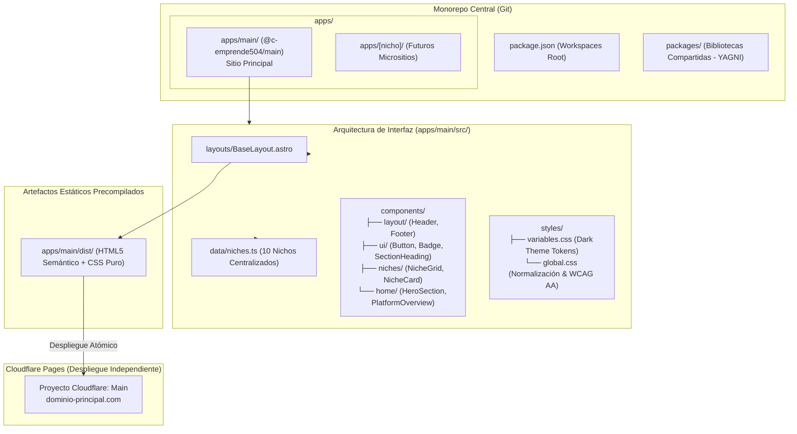

# C-Emprende504 — Arquitectura de Software
**Proyecto:** C-Emprende504  
**Rol:** Senior Software Architect & UI/UX Specialist  
**Supervisión:** Project Manager (ChatGPT)  
**Fecha:** 16 de noviembre de 2026  
**Versión:** 1.3.0 (Sprint 3 — Diseño Visual & Experiencia de Usuario)  
**Estado:** Arquitectura Visual y Monorepo Implementada  

---

## 1. Visión General del Sistema y Estilo Arquitectónico

**C-Emprende504** implementa una arquitectura **Jamstack (JavaScript, APIs, Markup)** estructurada como un **Monorepo gobernado mediante npm workspaces** con generación de sitios estáticos (**Static Site Generation - SSG**) utilizando **Astro 7**.

El sistema funciona como un portal central (`apps/main`) con un diseño en modo oscuro de alta legibilidad y acentos naranjas, preparado para estructurar la plataforma y dar acceso a futuros micrositios verticales independientes (`apps/[nicho]`).



### Principios Rectores:
1. **Zero-JS por Defecto:** Las páginas se generan como archivos HTML estáticos inmutables sin sobrecarga de frameworks frontend (sin React, Vue ni Angular).
2. **Estética Profesional Dark Theme:** Fondo oscuro (`#0B0B0B`), tarjetas con superficies sobrias (`#141414`), bordes sutiles (`#292929`) y acentos naranja (`#FF5A00`).
3. **Desacoplamiento Estricto:** La información de los 10 nichos potenciales reside en una estructura de datos tipada centralizada (`src/data/niches.ts`), evitando duplicación en los componentes.
4. **Mobile-First & Accesibilidad:** Diseñado y optimizado para pantallas desde 320px de ancho bajo pautas **WCAG 2.1 Nivel AA**, con ratios de contraste superiores a 7:1 y respeto por `prefers-reduced-motion`.
5. **Sin Falsas Afirmaciones:** Interfaz atractiva y profesional que refleja con honestidad el estado en preparación de los nichos, sin simular tiendas, valoraciones inventadas ni enlaces rotos.

---

## 2. Sistema de Diseño Visual y Tokens CSS

La paleta cromática y las variables de diseño residen en `apps/main/src/styles/variables.css`:

| Token CSS | Valor | Uso / Justificación Técnica |
| :--- | :--- | :--- |
| `--color-bg` | `#0B0B0B` | Fondo principal profundo de la aplicación. |
| `--color-surface` | `#141414` | Superficie de tarjetas (`.card`, `.niche-card`) y contenedores. |
| `--color-surface-subtle` | `#1A1A1A` | Fondo de elementos secundarios y estados hover. |
| `--color-border` | `#292929` | Borde sutil estándar para delimitar tarjetas y secciones. |
| `--color-border-hover` | `#3F3F46` | Borde reactivo al pasar el cursor. |
| `--color-primary` | `#FF5A00` | Naranja de acento visual para llamadas a la acción, isotipo y detalles destacados. |
| `--color-primary-hover` | `#FF7324` | Naranja reactivo en hover. |
| `--color-primary-text` | `#0B0B0B` | Texto oscuro de alto contraste ($\ge 6.2:1$) sobre fondo naranja. |
| `--color-text` | `#FFFFFF` | Texto principal con contraste máximo (> 19:1). |
| `--color-text-muted` | `#A1A1AA` | Texto secundario y párrafos con contraste > 7.5:1. |
| `--color-text-subtle` | `#71717A` | Texto de apoyo, leyendas e identificadores de orden. |

> [!NOTE]
> **Identidad Visual Provisional:** Esta paleta es una propuesta visual técnica para evaluar usabilidad y presentación. No constituye la marca comercial pública definitiva del proyecto.

---

## 3. Jerarquía y Modularidad de Componentes (`apps/main`)

```text
apps/main/src/components/
├── layout/
│   ├── Header.astro              # Cabecera sticky con navegación principal (Inicio, Nichos, Acerca de) y menú móvil accesible.
│   └── Footer.astro              # Pie de página con enlaces legales verificados y notas de transparencia.
├── ui/
│   ├── Button.astro              # Botón polimórfico accesible (<a> o <button>) con touch target >= 44px.
│   ├── Badge.astro               # Indicador visual de estado ('planning', 'preparation', 'accent').
│   └── SectionHeading.astro      # Encabezado modular para secciones (tag, título, descripción y alineación).
├── niches/
│   ├── NicheCard.astro           # Tarjeta individual de nicho con icono SVG, tag de orden (#01..#10), descripción y badge de estado.
│   └── NicheGrid.astro           # Cuadrícula responsiva que consume NICHES_DATA y distribuye las 10 categorías.
└── home/
    ├── HeroSection.astro         # Hero principal con resplandor naranja, titular persuasivo neutral, CTAs y métricas transparentes.
    └── PlatformOverview.astro    # Sección explicativa de los 3 pilares del ecosistema C-Emprende504.
```

---

## 4. Estructura de Datos Centralizada (`apps/main/src/data/niches.ts`)

Las diez categorías potenciales se definen en una estructura de datos inmutable y tipada:

```typescript
export interface NicheCategory {
  id: string;
  orderNumber: string;
  name: string;
  shortDescription: string;
  status: 'planning' | 'preparation';
  statusLabel: string;
  iconSvg: string; // Icono vectorial accesible embebido en SVG puro
}
```

### Reglas de Presentación:
- **Estado de Disponibilidad:** Las tarjetas muestran visualmente si se encuentran `En Planificación` o `En Preparación`.
- **Cero Enlaces Rotos:** No se generan enlaces hacia micrositios que todavía no existen; en su lugar, se incluye el indicador neutral *"Próximo Hub"*.
- **Preparación Futura:** Cuando un micrositio sea creado en `apps/[nicho]`, bastará con asignar la URL correspondiente en el objeto de datos para activar la tarjeta.

---

## 5. Diseño Adaptativo y Responsive Design

La cuadrícula de nichos (`.niches-grid`) y las secciones se adaptan automáticamente al viewport mediante CSS Grid y Flexbox nativo sin frameworks pesados:

- **Móviles pequeños (320px - 375px):** 1 columna, paddings compactos (`16px`), menú desplegable accesible.
- **Móviles estándar (390px - 430px):** 1 columna fluida con tamaño de fuente cómodo y touch targets amplios.
- **Tablets (640px - 1023px):** 2 columnas automáticas (`repeat(2, 1fr)`).
- **Escritorio (1024px en adelante):** 3 columnas balanceadas (`repeat(3, 1fr)`) con espaciado generoso (`32px`).

---

## 6. Despliegue en Cloudflare Pages

- **Aplicación Principal:** Desplegada desde la raíz `apps/main` con comando `npm run build` y directorio de salida `dist`.
- **Coste de Hosting:** $0.00 / mes en Cloudflare Pages Free Tier.
- **Cabeceras HTTP Especiales (CSP / HSTS):** Pospuestas formalmente para la fase de despliegue en producción y configuración de dominios, tal como solicitó el Project Manager.
