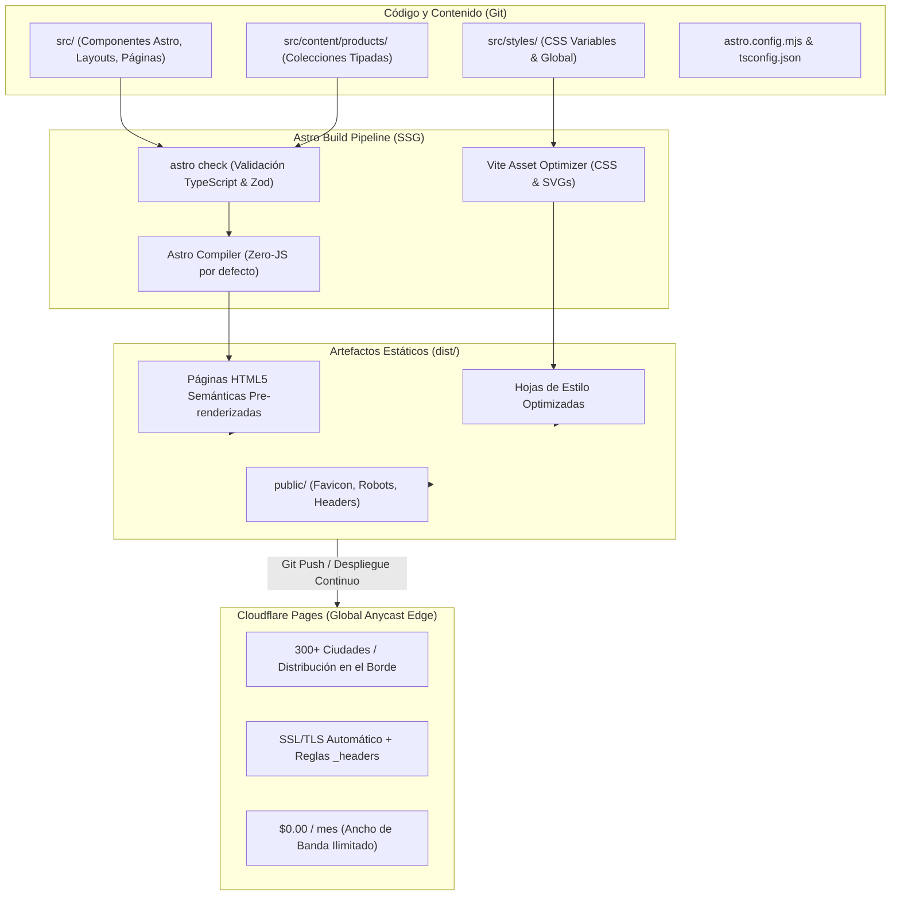

# C-Emprende504 — Arquitectura de Software
**Proyecto:** C-Emprende504  
**Rol:** Senior Software Architect & Astro Developer  
**Supervisión:** Project Manager (ChatGPT)  
**Fecha:** 16 de noviembre de 2026  
**Versión:** 1.1.0 (Sprint 1 — Cimientos de Infraestructura)  
**Estado:** Arquitectura Base Implementada  

---

## 1. Visión General del Sistema y Estilo Arquitectónico

**C-Emprende504** implementa una arquitectura **Jamstack (JavaScript, APIs, Markup)** basada en **Generación de Sitios Estáticos (Static Site Generation - SSG)** utilizando el motor **Astro**.



### Principios Rectores:
1. **Zero-JS por defecto:** Las páginas se generan como archivos HTML estáticos limpios sin sobrecarga de frameworks frontend (sin React, Vue ni Angular).
2. **Cero Infraestructura Activa:** No existe servidor Node.js ni base de datos activa en producción.
3. **Desacoplamiento Estricto:** La lógica de presentación está separada del modelo de datos de los productos.
4. **Mobile-First & Accesibilidad:** Diseñado prioritariamente para pantallas móviles bajo pautas WCAG 2.1 Nivel AA.

---

## 2. Arquitectura de Componentes

La capa de presentación en `src/` se organiza en una jerarquía modular:

```text
src/
├── layouts/
│   └── BaseLayout.astro        # Layout maestro: HTML5, <head>, A11y skip-link, Header, Footer
├── components/
│   ├── layout/
│   │   ├── Header.astro        # Cabecera sticky, navegación accesible, menú móvil sin dependencias
│   │   └── Footer.astro        # Pie de página, avisos legales, copyright, enlaces institucionales
│   ├── ui/
│   │   └── Button.astro        # Botón polimórfico accesible (renderiza <a> o <button>)
│   └── common/                 # Espacio reservado para metadatos SEO y componentes compartidos
└── pages/                      # Rutas estáticas del sistema
    ├── index.astro             # Home (Placeholder neutral de desarrollo)
    ├── about.astro             # Acerca del proyecto y principios de arquitectura
    ├── contact.astro           # Canal técnico de contacto (sin formularios CRM)
    ├── privacy.astro           # Política de privacidad (marco de cero recolección de datos)
    └── affiliate-disclosure.astro # Aviso de transparencia de afiliación (FTC)
```

---

## 3. Arquitectura de Datos: Colección de Productos (`products`)

El catálogo de infoproductos se gestiona de forma tipada mediante la API de **Content Collections** de Astro en `src/content.config.ts`.

### 3.1. Esquema Zod (`src/content.config.ts`)
```typescript
import { defineCollection } from 'astro:content';
import { z } from 'astro/zod';
import { glob } from 'astro/loaders';

const products = defineCollection({
  loader: glob({ pattern: '**/*.{md,json}', base: './src/content/products' }),
  schema: z.object({
    title: z.string(),
    slug: z.string(),
    description: z.string(),
    category: z.string(),
    featuredImage: z.string().optional(),
    affiliateUrl: z.url(),
    benefits: z.array(z.string()).default([]),
    targetAudience: z.array(z.string()).default([]),
    frequentlyAskedQuestions: z.array(
      z.object({
        question: z.string(),
        answer: z.string(),
      })
    ).default([]),
    status: z.enum(['draft', 'published', 'archived']).default('draft'),
    publishedAt: z.coerce.date().optional(),
  }),
});

export const collections = { products };
```

### 3.2. Regla de Catálogo Vacío en Fase de Cimientos
En estricto cumplimiento con las restricciones del Sprint 1, el directorio `src/content/products/` contiene **cero productos** (solo un archivo `.gitkeep`). No se han generado precios ficticios, testimonios inventados ni enlaces falsos de afiliación.

---

## 4. Sistema de Diseño y Tokens CSS

El sistema visual reside en `src/styles/` y se basa exclusivamente en variables nativas de CSS (CSS Custom Properties):

- **Tokens (`src/styles/variables.css`):**
  - Paleta neutral accesible (`--color-bg`, `--color-surface`, `--color-text`, `--color-border`).
  - Colores de acento preliminares (`--color-primary`, `--color-secondary`).
  - Escala tipográfica modular (`--text-xs` a `--text-4xl`) basada en sistema sans-serif del sistema operativo para evitar descargas bloqueantes de fuentes web.
  - Escala de espaciado modular (`--space-1` a `--space-16`).
  - Dimensiones de contenedor (`--container-max: 1200px`, `--container-narrow: 768px`).
- **Normalización (`src/styles/global.css`):**
  - Reset moderno (box-sizing, márgenes, alturas mínimas).
  - Enlace de salto de accesibilidad (`.skip-link` para lectores de pantalla y navegación por teclado).
  - Estados de foco visibles (`:focus-visible`) con contraste elevado.
  - Botones accesibles con tamaño de toque táctil mínimo de 44px (`.btn`, `.btn-primary`, `.btn-secondary`, `.btn-outline`).

---

## 5. Estrategia de Compilación y Despliegue en Cloudflare Pages

### 5.1. Configuración de Astro (`astro.config.mjs`)
```javascript
import { defineConfig } from 'astro/config';

export default defineConfig({
  output: 'static',
  build: {
    format: 'directory' // Genera /ruta/index.html para URLs limpias
  }
});
```

### 5.2. Parámetros para Cloudflare Pages
- **Framework Preset:** Astro
- **Build Command:** `npm run build`
- **Build Output Directory:** `dist`
- **Node.js Version:** 20.x o superior (verificado con Node v24 localmente).
- **Consumo de Recursos:** Costo $0.00 / mes (plan gratuito con solicitudes y ancho de banda ilimitados).
