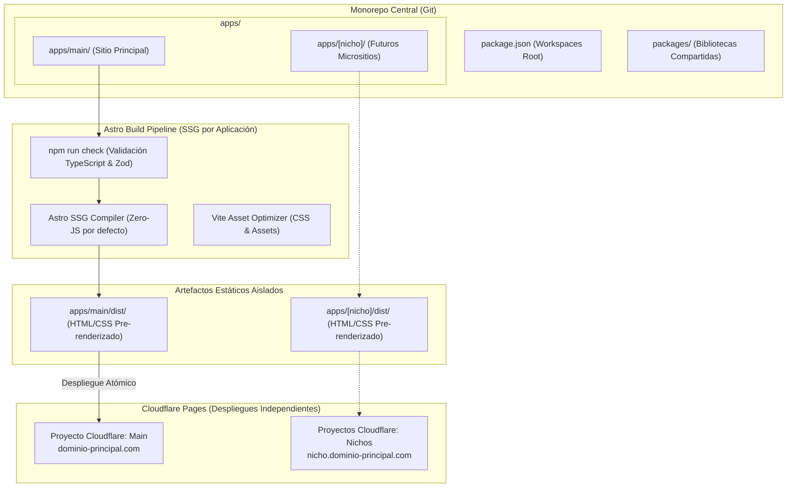

# C-Emprende504 — Arquitectura de Software
**Proyecto:** C-Emprende504  
**Rol:** Senior Software Architect & Astro Developer  
**Supervisión:** Project Manager (ChatGPT)  
**Fecha:** 16 de noviembre de 2026  
**Versión:** 1.2.0 (Sprint 2 — Arquitectura Monorepo y Escalabilidad Multi-Sitio)  
**Estado:** Arquitectura Monorepo Implementada  

---

## 1. Visión General del Sistema y Estilo Arquitectónico

**C-Emprende504** implementa una arquitectura **Jamstack (JavaScript, APIs, Markup)** estructurada como un **Monorepo gestionado mediante npm workspaces** con generación de sitios estáticos (**Static Site Generation - SSG**) utilizando **Astro**.

Esta arquitectura permite gobernar desde un único repositorio el sitio principal (`apps/main`) y, progresivamente, desplegar múltiples micrositios independientes para nichos específicos (`apps/[nicho]`) que cuenten con dominios o subdominios propios.



### Principios Rectores:
1. **Zero-JS por Defecto:** Las páginas se generan como archivos HTML estáticos inmutables sin sobrecarga de frameworks frontend (sin React, Vue ni Angular).
2. **Cero Infraestructura Activa:** No existe servidor Node.js ni base de datos activa en producción.
3. **Desacoplamiento Estricto:** La lógica de presentación está separada del modelo de datos de los productos y cada aplicación en `apps/` tiene su propio ciclo de vida.
4. **Despliegues Independientes:** Cada aplicación se compila y despliega de manera aislada en Cloudflare Pages.
5. **Mobile-First & Accesibilidad:** Diseñado prioritariamente para pantallas móviles bajo pautas WCAG 2.1 Nivel AA.

---

## 2. Arquitectura de Directorios del Monorepo

```text
C-Emprende504/
├── apps/                                 # Aplicaciones independientes
│   └── main/                             # Sitio principal (@c-emprende504/main)
│       ├── src/                          # Código fuente de la aplicación principal
│       │   ├── assets/                   # Activos optimizados (images/, icons/)
│       │   ├── components/               # Componentes UI modulares
│       │   ├── content/                  # Colección tipada products (0 productos)
│       │   ├── layouts/                  # BaseLayout.astro
│       │   ├── pages/                    # Rutas estáticas (/about, /privacy, etc.)
│       │   ├── styles/                   # Tokens CSS y estilos globales
│       │   └── content.config.ts         # Esquema Zod de productos
│       ├── public/                       # Activos estáticos públicos
│       │   ├── favicon.svg               # Favicon
│       │   └── media/                    # Carpetas organizadas para multimedia
│       │       ├── videos/               # (.gitkeep)
│       │       └── downloads/            # (.gitkeep)
│       ├── astro.config.mjs              # Configuración SSG de Astro
│       ├── package.json                  # Manifiesto workspace @c-emprende504/main
│       └── tsconfig.json                 # Configuración TypeScript
├── packages/                             # Espacio preparado para futuras bibliotecas compartidas
│   └── README.md                         # Principio YAGNI y lineamientos de abstracción
├── docs/                                 # Documentación técnica y estratégica central
│   ├── ARCHITECTURE.md
│   ├── DEVELOPMENT_GUIDE.md
│   ├── INITIAL_TECHNICAL_ASSESSMENT.md
│   ├── MULTI_SITE_STRATEGY.md
│   └── PROJECT_DISCOVERY.md
├── package.json                          # Configuración raíz de npm workspaces
├── package-lock.json                     # Árbol de dependencias bloqueadas del monorepo
├── tsconfig.json                         # Configuración TypeScript global (opcional)
└── .gitignore                            # Exclusiones de Git optimizadas para monorepo
```

---

## 3. Arquitectura de Componentes (`apps/main`)

La capa de presentación en `apps/main/src/` mantiene una jerarquía modular:

- **Layouts (`apps/main/src/layouts/`):**
  - `BaseLayout.astro`: Layout maestro con metadatos SEO, directiva `noindex, nofollow` para desarrollo, enlace de accesibilidad `.skip-link`, Header y Footer.
- **Componentes de Layout (`apps/main/src/components/layout/`):**
  - `Header.astro`: Cabecera sticky, navegación accesible y menú móvil sin dependencias externas.
  - `Footer.astro`: Pie de página accesible con enlaces de navegación y páginas de cumplimiento legal.
- **Componentes UI (`apps/main/src/components/ui/`):**
  - `Button.astro`: Botón polimórfico accesible (renderiza `<a>` o `<button>`) con tamaño táctil mínimo de 44px.

---

## 4. Arquitectura de Datos: Esquema de Productos

El catálogo de infoproductos se gestiona mediante la Content Layer API de Astro en `apps/main/src/content.config.ts`.

### 4.1. Esquema Zod Ajustado en Sprint 2
```typescript
import { defineCollection } from 'astro:content';
import { z } from 'astro/zod';
import { glob } from 'astro/loaders';

const products = defineCollection({
  loader: glob({ pattern: '**/*.{md,json}', base: './src/content/products' }),
  schema: z
    .object({
      title: z.string(),
      slug: z.string(),
      description: z.string(),
      category: z.string(),
      featuredImage: z.string().optional(),
      affiliateUrl: z.url().optional(), // Opcional en draft
      benefits: z.array(z.string()).default([]),
      targetAudience: z.array(z.string()).default([]),
      frequentlyAskedQuestions: z.array(
        z.object({
          question: z.string(),
          answer: z.string(),
        })
      ).default([]),
      status: z.enum(['draft', 'published', 'archived']).default('draft'),
      publishedAt: z.coerce.date().optional(),
    })
    .refine(
      (data) => {
        // En estado 'published', un producto de afiliación requiere obligatoriamente enlace de HotLink
        if (data.status === 'published' && !data.affiliateUrl) {
          return false;
        }
        return true;
      },
      {
        message: 'Los productos publicados (status: "published") requieren obligatoriamente un affiliateUrl válido.',
        path: ['affiliateUrl'],
      }
    ),
});

export const collections = { products };
```

### 4.2. Reglas del Esquema:
1. **Soporte de Borradores (Drafts):** Permite documentar fichas técnicas de infoproductos en borrador sin disponer aún de un HotLink autorizado.
2. **Blindaje de Publicación:** Ningún producto puede pasar a estado `published` sin un enlace de afiliado válido, evitando enlaces rotos en campañas.
3. **Cero Productos Simulados:** El catálogo se mantiene en **0 productos** en esta fase.

---

## 5. Organización y Manejo de Recursos Multimedia

- **Recursos Procesados (`apps/main/src/assets/`):** Imágenes e iconos procesados, redimensionados y optimizados a WebP/AVIF por Astro.
- **Archivos Estáticos Públicos (`apps/main/public/media/`):** Carpetas dedicadas `videos/` y `downloads/` para archivos servidos de forma estática directa.
- **Alojamiento Externo de Video:** Prohibición estricta de alojar videos de gran tamaño (VSL o demos) dentro del repositorio Git. Todo material audiovisual de gran tamaño se alojará en plataformas externas de streaming (YouTube no listado, Vimeo, Bunny Stream o Cloudflare Stream).

---

## 6. Despliegue en Cloudflare Pages en Entorno Monorepo

Cada aplicación se compila y sirve como un sitio estático aislado:

- **Sitio Principal (`apps/main`):**
  - **Root Directory:** `apps/main`
  - **Build Command:** `npm run build`
  - **Output Directory:** `dist`
- **Futuros Micrositios (`apps/[nicho]`):**
  - Mismo flujo con su respectivo subdirectorio como raíz en Cloudflare Pages.
- **Cero Coste Operativo:** El plan gratuito de Cloudflare Pages soporta múltiples proyectos con dominios personalizados y ancho de banda ilimitado.
