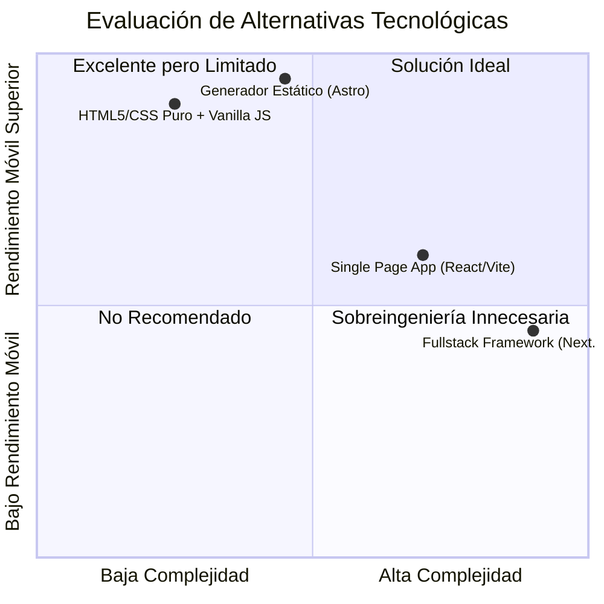
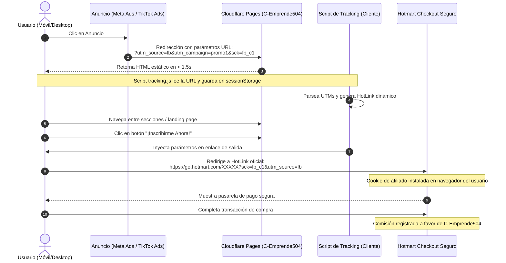
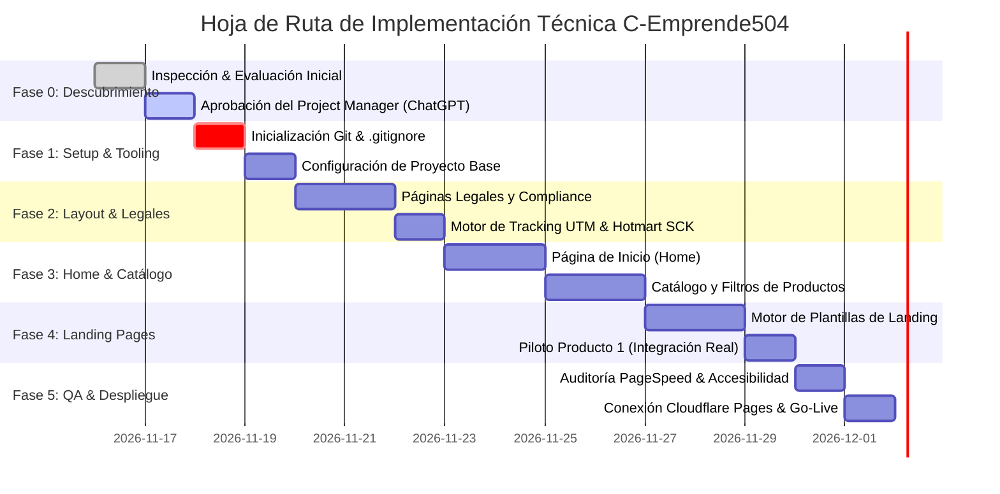

# C-Emprende504 — Evaluación Técnica Inicial y de Factibilidad
**Proyecto:** C-Emprende504  
**Rol:** Senior Software Architect & Technical Project Analyst  
**Supervisión:** Project Manager (ChatGPT)  
**Fecha:** 16 de noviembre de 2026  
**Versión:** 1.1.0 (Sprint 1 Ejecutado)  
**Estado:** Evaluación Base Completada y Cimientos Astro Inicializados  

---

## 1. Resultados de la Inspección del Entorno de Trabajo (Workspace Inspection)

### 1.1. Estado Inicial (Sprint 0 - Inspección Previa)
Se realizó una inspección exhaustiva del entorno local asignado al proyecto:

```text
Inspección ejecutada en: ~/Documents/VSCodeProjects/ProyectoComerciosAfiliados/C-Emprende504
Ruta absoluta: /home/cristiamsanchez/Documents/VSCodeProjects/ProyectoComerciosAfiliados/C-Emprende504
Sistema Operativo: Linux x86_64
```

| Parámetro Evaluado | Estado Inicial (Sprint 0) | Observación Técnica |
| :--- | :--- | :--- |
| **Contenido del Directorio** | Vacío (`.` y `..` únicamente) | El espacio de trabajo estaba completamente limpio. |
| **Control de Versiones (Git)** | **No Inicializado** | No existía directorio `.git` preexistente. |
| **Motor de Git del Sistema** | Instalado (`git version 2.43.0` en `/usr/bin/git`) | Verificado y funcional. |
| **Runtime de Node.js** | Instalado (`v24.19.0` gestionado vía NVM) | Versión moderna y estable. |
| **Gestor de Paquetes (npm)** | Instalado (`11.17.0`) | Disponible en el path del sistema. |
| **Python** | Instalado (`python3` en `/usr/bin/python3`) | Disponible en el sistema operativo. |

### 1.2. Estado Actualizado tras la Inicialización (Sprint 1)
- **Control de Versiones:** Repositorio Git inicializado exitosamente en rama `main` con reglas `.gitignore` completas y commit raíz inicial convencional.
- **Motor SSG:** Astro `v7.4.12` instalado y configurado con salida estática inmutable (`output: 'static'`).
- **Colección de Contenidos:** Esquema tipado Zod en `src/content.config.ts` para `products` con 0 productos registrados (catálogo limpio).
- **Herramientas de Diagnóstico:** `@astrojs/check` y `typescript` instalados como devDependencies (`npm run check` pasando con 0 errores, 0 advertencias, 0 hints).
- **Compilación Estática:** `npm run build` genera exitosamente las 5 rutas estáticas (`/`, `/about`, `/contact`, `/privacy`, `/affiliate-disclosure`) en `dist/` en 1.6 segundos.

---

## 2. Evaluación de Factibilidad Técnica

### 2.1. Factibilidad de Coste Cero ($0.00/mes)
- **Alojamiento y Red:** Cloudflare Pages ofrece un modelo comercial altamente favorable para proyectos de afiliados en fase de validación y escala. Su plan gratuito contempla:
  - Ancho de banda ilimitado y solicitudes ilimitadas en activos estáticos.
  - Red Anycast global con presencia en más de 300 ciudades, garantizando latencias inferiores a 50ms en Centroamérica y América Latina.
  - Certificados SSL/TLS automáticos y renovación administrada sin costo.
  - 500 compilaciones mensuales en Cloudflare Buildbots (más que suficiente para un flujo de publicación continuo).
- **Base de Datos y Backend:** Para el alcance actual de C-Emprende504, **no se requiere base de datos ni backend activo**. Toda la persistencia de transacciones, usuarios, pagos y procesamiento de cobros es delegada a **Hotmart**, lo que elimina por completo costes de servidores dedicados, instancias de bases de datos relacionales o funciones serverless facturables.

### 2.2. Factibilidad de Rendimiento y Core Web Vitals
- El tráfico proveniente de publicidad digital en redes sociales (Facebook Ads, Instagram, TikTok) presenta una tasa de rebote del 40% al 60% si la página tarda más de 3 segundos en cargar.
- Al emplear una arquitectura estática precompilada (HTML/CSS generado en build-time), el Time to First Byte (TTFB) se reduce a milisegundos desde el Edge de Cloudflare, garantizando un Largest Contentful Paint (LCP) inferior a 1.5 segundos en dispositivos móviles comunes.

---

## 3. Análisis Comparativo de Alternativas Arquitectónicas

Se realizó un análisis comparativo y ponderado entre tres enfoques técnicos viables para determinar la mejor solución técnica:



### Tabla Comparativa Detallada

| Criterio de Selección (Peso) | Enfoque A: HTML/CSS Modular + Vanilla JS (Vite) | Enfoque B: Generador Estático Moderno (Astro) | Enfoque C: SPA / Framework Pesado (Next.js) |
| :--- | :--- | :--- | :--- |
| **Rendimiento Móvil (30%)** | 9.5 / 10 (Cero runtime JS) | **9.8 / 10** (Zero-JS por defecto + optimización de assets) | 6.5 / 10 (Sobrecarga de hydration y CPU) |
| **Modularidad y Reutilización (25%)** | 6.5 / 10 (Requiere include scripts o templates) | **9.5 / 10** (Sintaxis de componentes reutilizables nativa) | 9.0 / 10 (Componentes React altamente reutilizables) |
| **Mantenibilidad del Catálogo (20%)** | 6.0 / 10 (Edición manual o scripts propios) | **9.5 / 10** (Colecciones de contenido basadas en Markdown/JSON) | 8.5 / 10 (Importación de datos estructurados) |
| **Simplicidad y Coste Operativo (15%)** | **10 / 10** (Sin dependencias complejas) | 9.0 / 10 (Mínimas dependencias de desarrollo) | 5.0 / 10 (Ecosistema propenso a breaking changes) |
| **Curva de Aprendizaje (10%)** | **10 / 10** (Estándares web universales) | 9.0 / 10 (HTML amigable con sintaxis intuitiva) | 6.0 / 10 (Manejo de estado, ciclos de vida y hydration) |
| **Puntaje Ponderado Total** | **8.15 / 10** | **9.45 / 10 (Ganador)** | **7.00 / 10** |

### Recomendación Arquitectónica Justificada
1. **Opción Recomendada:** **Astro**. Representa el equilibrio óptimo entre la pureza y ligereza del HTML tradicional con la productividad del desarrollo moderno basado en componentes. Astro compila a HTML puro sin JavaScript en el cliente a menos que se indique explícitamente una pequeña "isla" interactiva (como el acordeón de FAQ o el selector de categorías).
2. **Alternativa Directa (Sin Tooling Complejo):** Si el Project Manager prefiere no incorporar herramientas de compilación orientadas a componentes en este primer ciclo, la **Opción A (Vite + HTML/CSS modular + Vanilla JS)** es la alternativa recomendada por su extrema velocidad y total independencia de frameworks.

---

## 4. Arquitectura de Tracking, Atribución y Campañas

El éxito de una plataforma de afiliados depende de una rigurosa arquitectura de trazabilidad que prevenga la pérdida de comisiones.



### 4.1. Preservación de Parámetros UTM y Atribución Hotmart
1. **Captura en Primera Entrada:**
   Cuando un usuario aterriza en cualquier página del sitio (Home o Landing específica), un script ultra ligero (`tracking.js`) inspecciona `window.location.search`.
2. **Persistencia en `sessionStorage`:**
   Para evitar que el usuario pierda los parámetros de campaña al navegar entre la landing page y las páginas legales o el catálogo, los valores se guardan en el almacenamiento de sesión del navegador:
   - `utm_source`, `utm_medium`, `utm_campaign`, `utm_content`, `utm_term`.
   - `sck` (identificador de origen exclusivo de Hotmart para segmentar ventas en su panel).
3. **Inyección en Botones de Salida:**
   Al renderizar los botones de llamado a la acción (CTA), el script concatena de forma segura los parámetros almacenados al enlace base del afiliado (`https://go.hotmart.com/[CODIGO_HOTLINK]?sck=...`).
4. **Protección SEO y de Navegación:**
   Todos los enlaces salientes a Hotmart incorporarán los atributos:
   ```html
   <a href="https://go.hotmart.com/XXXXX" 
      target="_blank" 
      rel="sponsored noopener noreferrer" 
      class="btn-cta-primary">
      ¡Obtener Acceso Inmediato!
   </a>
   ```

---

## 5. Estrategia de Componentización y Modelo de Datos

Para cumplir con la regla de **mantener la funcionalidad de marketing independiente del contenido específico de los productos**, se define una arquitectura basada en datos:

### 5.1. Esquema Propuesto de Datos para Productos (`ProductSchema`)

Cada infoproducto de Hotmart se gestionará de manera declarativa a través de un documento JSON con el siguiente esquema estandarizado:

```json
{
  "$schema": "http://json-schema.org/draft-07/schema#",
  "title": "ProductData",
  "type": "object",
  "required": [
    "id",
    "slug",
    "name",
    "headline",
    "category",
    "hotmart",
    "pricing",
    "guaranteeDays"
  ],
  "properties": {
    "id": { "type": "string", "description": "Identificador interno único (ej. PROD-001)" },
    "slug": { "type": "string", "description": "URL amigable (ej. master-ventas-digitales)" },
    "name": { "type": "string", "description": "Nombre oficial del producto digital" },
    "headline": { "type": "string", "description": "Promesa de valor o titular persuasivo principal" },
    "category": { "type": "string", "description": "Categoría temática (ej. Emprendimiento, Marketing, Oficios)" },
    "badge": { "type": "string", "description": "Distintivo comercial (ej. Más Vendido, Oferta Especial)" },
    "instructor": {
      "type": "object",
      "properties": {
        "name": { "type": "string" },
        "bio": { "type": "string" },
        "avatarUrl": { "type": "string" }
      }
    },
    "pricing": {
      "type": "object",
      "required": ["currency", "regularPrice", "offerPrice"],
      "properties": {
        "currency": { "type": "string", "default": "USD" },
        "regularPrice": { "type": "number" },
        "offerPrice": { "type": "number" },
        "discountPercentage": { "type": "number" }
      }
    },
    "guaranteeDays": { "type": "integer", "enum": [7, 15, 30], "default": 7 },
    "hotmart": {
      "type": "object",
      "required": ["hotlinkUrl"],
      "properties": {
        "productId": { "type": "string" },
        "hotlinkUrl": { "type": "string", "format": "uri" }
      }
    },
    "benefits": {
      "type": "array",
      "items": { "type": "string" }
    },
    "curriculum": {
      "type": "array",
      "items": {
        "type": "object",
        "properties": {
          "moduleNumber": { "type": "integer" },
          "title": { "type": "string" },
          "lessons": { "type": "array", "items": { "type": "string" } }
        }
      }
    },
    "faqs": {
      "type": "array",
      "items": {
        "type": "object",
        "properties": {
          "question": { "type": "string" },
          "answer": { "type": "string" }
        }
      }
    }
  }
}
```

---

## 6. Configuración de Despliegue en Cloudflare Pages

El despliegue en Cloudflare Pages se optimizará mediante dos archivos de configuración ubicados en la raíz pública:

### 6.1. Reglas de Cabeceras HTTP de Seguridad (`public/_headers`)
```text
/*
  X-Content-Type-Options: nosniff
  X-Frame-Options: SAMEORIGIN
  Referrer-Policy: strict-origin-when-cross-origin
  Permissions-Policy: geolocation=(), microphone=(), camera=()
  Content-Security-Policy: default-src 'self'; script-src 'self' 'unsafe-inline' https://connect.facebook.net https://www.googletagmanager.com; img-src 'self' data: https:; style-src 'self' 'unsafe-inline' https://fonts.googleapis.com; font-src 'self' https://fonts.gstatic.com; connect-src 'self' https://www.facebook.com https://*.google-analytics.com;

# Caché inmutable para activos estáticos con hash
/assets/*
  Cache-Control: public, max-age=31536000, immutable

# Caché corta para documentos HTML
/*.html
  Cache-Control: public, max-age=0, must-revalidate
```

### 6.2. Reglas de Redirección Limpia (`public/_redirects`)
Permitirá crear URLs de campaña cortas y memorables para anuncios o redes sociales que redirigen directamente al HotLink con paso de parámetros:
```text
/go/emprendimiento-digital  https://go.hotmart.com/XXXXXXX?sck=cf_redirect  302
/go/ventas-online           https://go.hotmart.com/YYYYYYY?sck=cf_redirect  302
```

---

## 7. Plan de Fases y Hoja de Ruta Técnica (Technical Roadmap)



| Fase | Alcance y Entregables Clave | Prerrequisito para Iniciar |
| :--- | :--- | :--- |
| **Fase 0: Descubrimiento (Actual)** | Inspección de entorno, `README.md`, `PROJECT_DISCOVERY.md` y `INITIAL_TECHNICAL_ASSESSMENT.md`. | N/A |
| **Fase 1: Configuración de Base** | Inicialización de Git, `.gitignore`, setup del generador aprobado y configuración de scripts de compilación. | **Aprobación formal del Project Manager (ChatGPT)** |
| **Fase 2: Infraestructura Legal y Tracking** | Implementación de páginas obligatorias (`aviso-afiliados.html`, `privacidad.html`, `terminos.html`, `contacto.html`) y script `tracking.js`. | Conclusión de Fase 1 |
| **Fase 3: Home y Catálogo** | Creación del layout global, diseño de la página de inicio, sistema de filtrado de productos y carga de datos desde `categories.json`. | Conclusión de Fase 2 |
| **Fase 4: Motor de Landing Pages y Piloto** | Implementación de los módulos de landing page (hero, VSL, temario, garantías, FAQs, botones CTA dinámicos) y publicación del primer producto piloto de Hotmart. | Suministro de HotLinks y ficha técnica de los productos por parte del Project Manager |
| **Fase 5: Optimización y Despliegue** | Verificación de Core Web Vitals en móvil ($\ge 90$), auditoría de cumplimiento publicitario y conexión de despliegue continuo en Cloudflare Pages. | Conclusión de Fase 4 |
