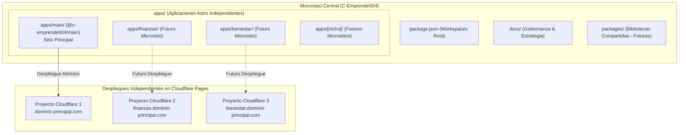

# C-Emprende504 — Estrategia Multi-Sitio y Escalabilidad Monorepo
**Proyecto:** C-Emprende504  
**Rol:** Senior Software Architect & Technical Lead  
**Supervisión:** Project Manager (ChatGPT)  
**Fecha:** 16 de noviembre de 2026  
**Versión:** 1.0.0 (Sprint 2 — Arquitectura Multi-Sitio)  
**Estado:** Estrategia Aprobada e Implementada  

---

## 1. Visión y Justificación del Modelo Monorepo

El proyecto **C-Emprende504** adopta una arquitectura de **Monorepo gestionado mediante npm workspaces** para gobernar desde un único repositorio centralizado el sitio principal y, progresivamente, los futuros micrositios verticales de nicho que demuestren viabilidad comercial.



### 1.1. Principios Fundamentales del Monorepo:
1. **Desacoplamiento Operativo:** Cada aplicación dentro de `apps/` es un proyecto Astro completo, autónomo y con su propio ciclo de vida.
2. **Cero Multi-tenancy en Runtime:** No se utiliza lógica condicional en el navegador ni frameworks complejos en servidor para simular múltiples sitios. Cada sitio es una compilación estática (SSG) inmutable y separada.
3. **Gestión Unificada de Tooling:** Las dependencias centrales de desarrollo (Astro, TypeScript, linters) se gestionan eficientemente desde la raíz, evitando redundancias en disco.
4. **Despliegues Aislados:** Una actualización o fallo en un micrositio específico jamás afectará la disponibilidad del sitio principal ni de otros nichos.

---

## 2. Ubicación del Sitio Principal (`apps/main`)

La aplicación Astro desarrollada durante el Sprint 1 ha sido migrada íntegramente a:

```text
apps/main/
├── src/
│   ├── assets/               # Imágenes e iconos optimizados
│   ├── components/           # Header, Footer, Button, componentes de layout
│   ├── content/              # Colección tipada products (0 productos)
│   ├── layouts/              # BaseLayout.astro
│   ├── pages/                # Rutas estáticas (/about, /privacy, etc.)
│   ├── styles/               # Tokens CSS y estilos globales
│   └── content.config.ts     # Esquema Zod de productos con affiliateUrl opcional
├── public/
│   ├── favicon.svg           # Favicon SVG preliminar
│   └── media/                # Carpetas organizadas para multimedia estática
│       ├── videos/           # (.gitkeep)
│       └── downloads/        # (.gitkeep)
├── astro.config.mjs          # Configuración estática SSG
├── package.json              # Identificador: @c-emprende504/main
└── tsconfig.json             # Configuración TypeScript estricta
```

---

## 3. Catálogo de Nichos Potenciales Identificados

Durante la fase de planificación estratégica se identificaron **10 categorías verticales con potencial** en el mercado hispanohablante de productos digitales de Hotmart:

| N.º | Categoría / Nicho Potencial | Justificación Estratégica Preliminar |
| :---: | :--- | :--- |
| **1** | **Finanzas** | Gestión financiera personal, inversiones básicas, tributación y educación patrimonial. |
| **2** | **Salud y Bienestar** | Nutrición, entrenamiento físico, hábitos saludables y manejo del estrés. |
| **3** | **Belleza y Estética** | Maquillaje profesional, cuidado de la piel, barbería, micropigmentación y estética no invasiva. |
| **4** | **Mascotas** | Adiestramiento canino, nutrición animal casera y primeros auxilios para mascotas. |
| **5** | **Marketing Digital** | Publicidad en Meta/TikTok Ads, copywriting, gestión de redes sociales y creación de contenido. |
| **6** | **Inteligencia Artificial** | Productividad con IA generativa, automatización de flujos de trabajo y herramientas para negocios. |
| **7** | **Desarrollo Personal** | Gestión del tiempo, liderazgo, oratoria, idiomas y superación de la procrastinación. |
| **8** | **Negocios Online** | E-commerce, dropshipping, servicios freelance y creación de agencias digitales. |
| **9** | **Relaciones** | Comunicación de pareja, habilidades sociales y resolución de conflictos interpersonales. |
| **10** | **Espiritualidad** | Mindfulness, meditación, yoga y crecimiento interior. |

> [!IMPORTANT]
> **Criterio de Validación Previa:** Estas categorías representan hipótesis y oportunidades de mercado, **NO decisiones comerciales definitivas**.  
> **No se creará ningún micrositio** para estas categorías hasta que se cumplan las 4 condiciones de viabilidad:
> 1. Verificación de demanda real y volumen de búsqueda en la audiencia objetivo.
> 2. Existencia en Hotmart de infoproductos de probada satisfacción (calificación alta, bajo ratio de reembolso y garantía oficial transparente).
> 3. Aprobación del productor para la comercialización afiliada y asignación de HotLinks autorizados.
> 4. Definición de una propuesta de valor persuasiva y ética que cumpla las normativas publicitarias de Meta y Google Ads.

---

## 4. Estrategia de Subdominios y Despliegue en Cloudflare Pages

### 4.1. Mapeo de Dominios
Cuando se adquiera el dominio oficial definitivo del proyecto, la arquitectura permitirá la siguiente asignación limpia:

- **Sitio Principal:** `https://dominio-principal.com` (o `https://c-emprende504.pages.dev` en staging).
- **Micrositios Verticales:** Subdominios dedicados (ej. `https://finanzas.dominio-principal.com`, `https://mascotas.dominio-principal.com`) o dominios de marca independientes si el nicho requiere identidad propia.

### 4.2. Configuración en Cloudflare Pages
Cada carpeta bajo `apps/` se conectará a Cloudflare Pages como un **proyecto independiente**:

| Parámetro | Configuración Sitio Principal | Configuración Futuro Micrositio (Ejemplo) |
| :--- | :--- | :--- |
| **Repositorio Git** | Mismo repositorio monorepo | Mismo repositorio monorepo |
| **Root Directory** | `apps/main` | `apps/finanzas` |
| **Build Command** | `npm run build` | `npm run build` |
| **Output Directory** | `dist` (resuelve a `apps/main/dist`) | `dist` (resuelve a `apps/finanzas/dist`) |
| **Node.js Version** | `20` o superior | `20` o superior |
| **Variables de Entorno** | Específicas de la aplicación | Específicas del micrositio |

Esta técnica aprovecha al máximo el tier gratuito de Cloudflare Pages: cada proyecto disfruta de su propio subdominio `.pages.dev`, certificados SSL automáticos y límites de ancho de banda ilimitados sin interferencias entre aplicaciones.

---

## 5. Procedimiento para Añadir un Nuevo Micrositio

Cuando el Project Manager apruebe la apertura de un nuevo nicho validado (por ejemplo, `apps/finanzas`), se seguirá el siguiente procedimiento estandarizado:

1. **Crear el directorio de la aplicación:**
   ```bash
   mkdir -p apps/finanzas
   ```
2. **Crear su `package.json` propio con el namespace corporativo:**
   ```json
   {
     "name": "@c-emprende504/finanzas",
     "version": "0.1.0",
     "type": "module",
     "private": true,
     "scripts": {
       "dev": "astro dev",
       "build": "astro build",
       "preview": "astro preview",
       "check": "astro check"
     },
     "dependencies": {
       "astro": "^7.4.12"
     },
     "devDependencies": {
       "@astrojs/check": "^0.9.12",
       "typescript": "^6.0.3"
     }
   }
   ```
3. **Copiar las configuraciones base:**
   - `astro.config.mjs` (con `output: 'static'`).
   - `tsconfig.json`.
4. **Definir la estructura de carpetas (`src/` y `public/`):**
   - Configurar `src/content.config.ts` para su catálogo específico.
   - Definir estilos y componentes con la identidad visual adaptada a ese nicho.
5. **Ejecutar `npm install` desde la raíz:**
   - npm workspaces detectará automáticamente la nueva aplicación en `apps/finanzas` y enlazará las dependencias de inmediato.
6. **Añadir el script de delegación en el `package.json` raíz (opcional):**
   ```json
   "build:finanzas": "npm run build --workspace=@c-emprende504/finanzas"
   ```

---

## 6. Organización de Recursos Multimedia

Para preservar la ligereza del repositorio Git y maximizar la velocidad de carga (Core Web Vitals):

### 6.1. Recursos Procesados por Astro (`src/assets/`)
- **Ubicación:** `apps/[app-name]/src/assets/images/` y `apps/[app-name]/src/assets/icons/`.
- **Uso:** Logotipos, avatares de instructores, iconos vectoriales e imágenes de interfaz.
- **Ventaja:** Astro optimiza automáticamente formatos (conversión a WebP/AVIF), dimensiones y atributos `srcset` en tiempo de compilación.

### 6.2. Archivos Públicos sin Procesamiento (`public/media/`)
- **Ubicación:** `apps/[app-name]/public/media/videos/` y `apps/[app-name]/public/media/downloads/`.
- **Uso:** Favicons, descargables PDF ligeros (ej. fichas técnicas o descargables gratuitos).

### 6.3. Política Estricta sobre Videos y Archivos Pesados
- **PROHIBIDO** almacenar videos de ventas (VSL), archivos MP4 o material promocional de gran tamaño en el repositorio Git.
- **Recomendación Técnica:** Todos los videos promocionales deben alojarse en plataformas externas especializadas (YouTube en modo no listado, Vimeo, Bunny Stream o Cloudflare Stream) e incrustarse mediante reproductores optimizados o enlaces diferidos.

---

## 7. Esquema de Productos: Flexibilidad en Estado Draft

En el Sprint 2 se flexibilizó el esquema de colecciones de contenido (`src/content.config.ts`):

- **El campo `affiliateUrl` es opcional en la definición base:**
  ```typescript
  affiliateUrl: z.url().optional()
  ```
- **Regla de Validación Condicional:**
  - Los productos en estado `draft` pueden guardarse sin enlace de afiliado mientras se recopila la información del curso.
  - Los productos en estado `published` **requieren obligatoriamente** un `affiliateUrl` válido verificado por Zod antes de poder compilar.
- **Garantía:** Es imposible publicar por error una página de afiliación activa cuyo enlace de compra apunte a la nada o esté roto.

---

## 8. Decisiones Pendientes y Restricciones Estrictas

### Decisiones Pendientes (Requieren Aprobación del PM):
1. Adquisición del dominio comercial oficial y definición de los subdominios iniciales.
2. Selección del primer producto digital de Hotmart con su respectivo HotLink autorizado.
3. Definición del primer nicho vertical a evaluar tras la consolidación del sitio principal.

### Restricciones Vigentes:
- NO crear directorios para los nichos potenciales hasta su validación formal.
- NO crear productos ficticios, precios simulados ni testimonios no provistos por Hotmart.
- NO integrar herramientas de tracking publicitario (Meta Pixel, Google Analytics, UTMs dinámicas) hasta disponer de páginas de producto reales.
- NO implementar bases de datos ni backends.
