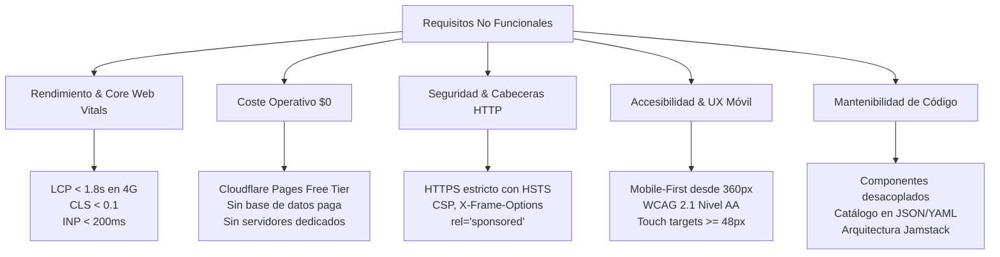
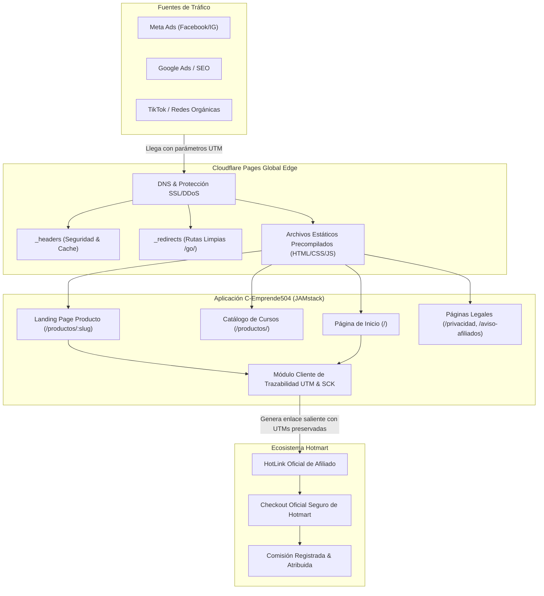

# C-Emprende504 — Documento de Descubrimiento del Proyecto
**Proyecto:** C-Emprende504  
**Rol:** Senior Business Analyst & Software Architect  
**Supervisión:** Project Manager (ChatGPT)  
**Fecha:** 16 de noviembre de 2026  
**Versión:** 1.1.0 (Descubrimiento Aprobado & Sprint 1 en Ejecución)  
**Estado:** Arquitectura Astro Aprobada por el Project Manager  

---

## 1. Resumen del Proyecto (Project Overview)

El proyecto **C-Emprende504** consiste en el diseño, arquitectura e implementación de una plataforma web profesional de marketing de afiliados orientada a la promoción y comercialización ética y de alta conversión de productos digitales (cursos online, programas de certificación, e-books y herramientas formativas) alojados en la plataforma **Hotmart**.

El sistema actuará como un ecosistema puente entre audiencias interesadas en superación profesional/emprendimiento y los infoproductos comercializados a través del programa de afiliados de Hotmart. La plataforma presentará:
1. Una **Página de Inicio (Home)** con posicionamiento de marca, propuesta de valor y catálogo de productos destacados.
2. Un **Catálogo de Productos** estructurado y categorizado.
3. **Landing Pages específicas por producto**, con arquitectura de persuasión orientada a la conversión, optimizadas para dispositivos móviles y tráfico proveniente de publicidad digital.
4. Un sistema de **enrutamiento y trazabilidad de tráfico** que dirija a los usuarios a los checkouts oficiales de Hotmart asegurando la correcta atribución de comisiones (HotLinks, HotLeads y parámetros UTM).
5. Páginas de **cumplimiento normativo, legal y de privacidad** (Divulgación de Afiliados, Política de Privacidad, Términos y Contacto).

El proyecto se concibe bajo una premisa fundamental de eficiencia financiera: **coste de infraestructura recurrente cero ($0.00/mes)** en su fase inicial, apalancándose en la infraestructura de computación en el borde (Edge) de Cloudflare Pages y arquitecturas estáticas de alto rendimiento.

---

## 2. Objetivos de Negocio (Business Objectives)

| ID | Objetivo Comercial | Indicador Clave (KPI) / Meta |
| :--- | :--- | :--- |
| **OBJ-01** | **Maximización de Conversión de Tráfico** | Lograr un Click-Through-Rate (CTR) $\ge 15\%$ en botones de llamado a la acción (CTA) hacia el checkout de Hotmart en landing pages específicas. |
| **OBJ-02** | **Atribución Garantizada de Comisiones** | Cero fugas de comisiones de afiliados mediante propagación estricta de parámetros UTM y código de seguimiento Hotmart (`sck`). |
| **OBJ-03** | **Cero Costes de Infraestructura Fija** | Mantener los costes de hosting, CDN y despliegue en \$0.00 USD durante la fase de validación y escalado inicial mediante el tier gratuito de Cloudflare Pages. |
| **OBJ-04** | **Excelente Experiencia Móvil** | Tiempos de carga en redes móviles 3G/4G inferiores a 2.0 segundos (Core Web Vitals óptimos: LCP < 1.8s, INP < 200ms, CLS < 0.1). |
| **OBJ-05** | **Construcción de Confianza y Autoridad de Marca** | Consolidar a C-Emprende504 como un portal curador confiable, evitando la percepción de "sitio de spam" o páginas de aterrizaje genéricas de baja calidad. |
| **OBJ-06** | **Escalabilidad y Agilidad Operativa** | Capacidad de incorporar un nuevo infoproducto al catálogo y publicar su landing page en menos de 30 minutos sin requerir despliegues complejos ni reescritura de código. |
| **OBJ-07** | **Cumplimiento Publicitario y Legal Estricto** | Cumplir 100% con las políticas de Meta Ads, Google Ads y normativas de transparencia (FTC) para mitigar el riesgo de baneo de cuentas publicitarias. |

---

## 3. Público Objetivo: Supuestos y Preguntas Abiertas

### 3.1. Supuestos de la Audiencia
1. **Segmentación Geográfica:**
   - Mercado primario: Honduras (identificado simbólicamente por el prefijo 504) y Centroamérica.
   - Mercado secundario: Audiencia hispanohablante en América Latina y comunidad hispana en Estados Unidos y España.
2. **Dispositivos y Conectividad:**
   - Más del 80% del tráfico ingresará a través de teléfonos inteligentes (smartphones Android e iOS) derivado de redes sociales (Instagram, Facebook, TikTok, YouTube).
   - Un porcentaje relevante de usuarios navegará a través de redes celulares de velocidad moderada o conexiones Wi-Fi de latencia variable, lo que exige un peso de página extremadamente ligero (< 500 KB sin video).
3. **Comportamiento y Psicología de Compra:**
   - Los prospectos buscan formación práctica para generar ingresos, emprender negocios locales o digitales, aprender habilidades técnicas o mejorar su empleabilidad.
   - Son altamente sensibles a la credibilidad del sitio: requieren ver testimonios legítimos (provistos por el productor en Hotmart), garantías de devolución de dinero de Hotmart (7 a 15 días) y pasarelas de pago seguras y locales reconocidas.
   - Necesitan claridad sobre qué recibirán inmediatamente tras el pago (acceso digital por correo electrónico).

### 3.2. Preguntas Abiertas para el Project Manager
1. **¿Micronicho enfocado o Portal Multicategoría?**  
   *¿Se iniciará la plataforma con un único nicho temático (ejemplo: emprendimiento digital, gastronomía, oficios técnicos) o con un catálogo diversificado de varias áreas de interés desde el primer día?*
2. **¿Tono y Voz de la Marca C-Emprende504?**  
   *¿La comunicación será institucional y corporativa (orientada a un portal de formación), aspiracional y motivacional (orientada a la comunidad emprendedora), o técnica y directa?*
3. **¿Estrategia de Captura de Leads en Fase 1?**  
   *¿El tráfico se enviará de forma 100% directa desde las landing pages al checkout de Hotmart, o se contempla capturar prospectos mediante grupos de WhatsApp/Telegram o listas de correo antes de la venta?*
4. **¿Disponibilidad de Activos y Hotlinks Iniciales?**  
   *¿Cuáles son los primeros 1 a 3 productos de Hotmart aprobados para afiliación con los que comenzaremos la arquitectura de prueba y validación?*

---

## 4. Requisitos Funcionales Preliminares (PFR)

### Módulo 1: Navegación y Páginas Globales
- **RF-01 (Página de Inicio / Home):** Presentar la propuesta de valor de C-Emprende504, banner principal (Hero section), catálogo de productos destacados, categorías temáticas, testimonios/garantías globales y llamado a la acción principal.
- **RF-02 (Catálogo de Productos):** Vista de listado donde los usuarios pueden filtrar productos por categoría, nivel de dificultad y etiquetas, además de un buscador básico del lado del cliente.
- **RF-03 (Páginas Legales y de Cumplimiento):**
  - *Affiliate Disclosure (Divulgación de Afiliados):* Explicación clara y transparente de que el sitio recibe comisiones por compras realizadas a través de los enlaces, sin costo adicional para el comprador.
  - *Política de Privacidad:* Declaración de tratamiento de datos personales, uso de cookies y herramientas de medición.
  - *Términos y Condiciones de Uso.*
  - *Página de Contacto y Soporte:* Formulario o canales de contacto directo (correo electrónico, canal oficial).

### Módulo 2: Motor de Landing Pages de Producto
- **RF-04 (Landing Pages Modulares):** Generación de páginas dedicadas por producto bajo la ruta `/productos/[slug]/` con las siguientes secciones configurables:
  - Hero persuasivo con título de gancho y llamada a la acción superior.
  - Sección de video de ventas (VSL) o imagen destacada.
  - Cuadrícula de problemas resueltos y dolores del cliente.
  - Temario detallado y beneficios del programa formativo.
  - Perfil del instructor o creador del contenido.
  - Desglose de bonos exclusivos (si aplican según la oferta del productor).
  - Bloque de garantía oficial de Hotmart (7, 15 o 30 días con devolución garantizada).
  - Sección de Preguntas Frecuentes (FAQ) en formato acordeón.
  - Botón de compra / CTA persistente o sticky bar en móvil.

### Módulo 3: Enrutamiento y Trazabilidad de Afiliados
- **RF-05 (Propagación Dinámica de UTMs y Atribución):** Capturar los parámetros de campaña entrantes en la URL (`utm_source`, `utm_medium`, `utm_campaign`, `utm_content`, `utm_term`) y transmitirlos de forma íntegra a los enlaces salientes de Hotmart utilizando el parámetro de seguimiento de Hotmart (`sck`).
- **RF-06 (Redirecciones Limpias / Enlaces de Salida):** Proveer un esquema de enlaces internos limpios (ej. `/go/[producto]`) que apliquen atributos de seguridad `rel="sponsored noopener noreferrer"` para proteger el posicionamiento SEO y la reputación de dominio.

### Módulo 4: Preparación para Analítica y Marketing Digital
- **RF-07 (Inyección de Píxeles de Conversión):** Contenedor preparado para la incorporación limpia de Meta Pixel (Facebook Pixel) y Google Analytics 4 sin bloquear el renderizado inicial de la página.
- **RF-08 (Eventos de Conversión en el Cliente):** Disparo de eventos personalizados (`InitiateCheckout`, `Lead`, `ViewContent`) al hacer clic en los enlaces de compra de afiliados.

---

## 5. Requisitos No Funcionales Preliminares (PNFR)



- **RNF-01 (Rendimiento Web):** Puntuación mínima de 90/100 en Google PageSpeed Insights (móvil y escritorio). LCP < 1.8 segundos, INP < 200 milisegundos, CLS < 0.1.
- **RNF-02 (Coste de Infraestructura):** \$0.00 de gasto recurrente inicial. Despliegue 100% estático en Cloudflare Pages, aprovechando su cuota ilimitada de ancho de banda y solicitudes en el tier gratuito.
- **RNF-03 (Seguridad y Resiliencia):** Servir bajo HTTPS obligatorio mediante certificados SSL/TLS emitidos automáticamente en el borde de Cloudflare. Cabeceras de seguridad estrictas configuradas vía `_headers`.
- **RNF-04 (Diseño Responsivo y Mobile-First):** Interfaz adaptativa optimizada prioritariamente para pantallas de smartphones (desde 360px de ancho) hasta monitores ultrawide.
- **RNF-05 (Accesibilidad Web):** Cumplimiento con las pautas WCAG 2.1 nivel AA: ratios de contraste adecuados ($\ge 4.5:1$), etiquetas semánticas para lectores de pantalla y navegación asistida por teclado.
- **RNF-06 (Mantenibilidad y Desacoplamiento):** El código del frontend debe estar completamente desacoplado del contenido. Los productos se administrarán como entidades de datos (ficheros de datos estructurados), permitiendo agregar o modificar productos sin alterar la estructura del código.

---

## 6. Alternativas Tecnológicas Recomendadas

Para cumplir con la directriz de **no asumir bases de datos ni backends prematuros** y priorizar el rendimiento, simplicidad y coste cero, se evaluaron tres alternativas arquitectónicas:

| Criterio | Opción 1: HTML5 + CSS + Vanilla JS (Con Vite) | Opción 2: Generador de Sitios Estáticos (Astro) | Opción 3: Framework React/Next.js (Export Estático) |
| :--- | :--- | :--- | :--- |
| **Sobrecarga de JavaScript** | **Nula** (0 KB runtime JS) | **Mínima** (Islands architecture: 0 KB por defecto) | **Alta** (React runtime + hydration, ~80-140 KB) |
| **Rendimiento Móvil (LCP)** | Ultra rápido (< 1.0s) | Ultra rápido (< 1.2s) | Moderado / Dependiente de CPU móvil |
| **Reutilización de Componentes** | Limitada (vía plantillas HTML o scripts) | **Excelente** (sintaxis de componentes `.astro`) | Excelente (componentes React) |
| **Gestión de Catálogo (Datos)** | Manual o mediante scripts de build sencillos | **Nativa** (Colecciones de contenido tipadas) | Nativa (importación de JSON) |
| **Complejidad de Mantenimiento** | Baja al inicio, media al escalar a 30+ productos | **Baja y altamente escalable** | Media / Alta (dependencias complejas, breaking changes) |
| **Curva de Aprendizaje** | Mínima | Baja (HTML y Markdown enriquecido) | Media |
| **Costo de Hosting en Cloudflare Pages** | \$0.00 / mes | \$0.00 / mes | \$0.00 / mes |

### Recomendación Técnica del Arquitecto
Se recomienda formalmente la **Opción 2 (Astro)** o en su defecto una transición guiada desde la **Opción 1**:
- **Astro** entrega HTML puro pre-renderizado en tiempo de compilación (Zero-JS por defecto), lo que garantiza puntuaciones perfectas en PageSpeed y carga instantánea en teléfonos móviles económicos.
- Permite manejar el catálogo de productos de Hotmart mediante archivos Markdown/JSON con validación de esquema, haciendo que publicar una nueva landing page sea tan simple como agregar un archivo de datos.
- Si el Project Manager prefiere una aproximación aún más pura y minimalista sin herramientas de compilación complejas para la fase preliminar, la **Opción 1 (Vite + HTML/CSS modular + Vanilla JS)** representa la alternativa más liviana posible.

---

## 7. Arquitectura de Aplicación Propuesta



### Principios Fundamentales de la Arquitectura:
1. **JAMstack Puro (JavaScript, APIs, Markup):** No existe servidor Node.js corriendo en producción ni base de datos SQL/NoSQL que genere vulnerabilidades o latencias.
2. **Pre-renderizado en Build Time (SSG):** Todas las páginas se compilan como HTML estático inmutable antes de publicarse. El usuario recibe el contenido listo para pintar en el navegador sin esperas.
3. **Capa de Abstracción de Datos:** Los productos se definen en una estructura de datos centralizada. Ningún enlace de afiliado o texto de producto se inserta de forma "hardcodeada" en el marcado de las plantillas.
4. **Motor de Tracking en el Cliente:** Un script de escasos bytes intercepta la URL de entrada, persiste los parámetros UTM en la sesión de navegación y los anexa automáticamente a los botones de llamado a la acción.

---

## 8. Estructura de Directorios Propuesta

A continuación se presenta la propuesta de organización modular para el proyecto cuando se autorice su desarrollo:

```text
C-Emprende504/
├── .github/                      # Flujos de trabajo de CI/CD para auditorías automáticas (opcional)
│   └── workflows/
├── docs/                         # Documentación técnica, comercial y arquitectónica
│   ├── PROJECT_DISCOVERY.md
│   ├── INITIAL_TECHNICAL_ASSESSMENT.md
│   └── ARCHITECTURE_DECISIONS.md
├── public/                       # Activos estáticos directos (servidos tal cual)
│   ├── favicon.ico
│   ├── robots.txt
│   ├── sitemap.xml
│   ├── _headers                  # Configuración de cabeceras HTTP de Cloudflare Pages
│   ├── _redirects                # Reglas de redirección de Cloudflare Pages (/go/...)
│   └── images/
│       ├── branding/             # Logotipos, isotipo de C-Emprende504
│       └── products/             # Mockups, portadas y banners optimizados (WebP/AVIF)
├── src/                          # Código fuente de la aplicación
│   ├── assets/                   # Estilos globales y fuentes tipográficas
│   │   └── styles/
│   │       ├── main.css
│   │       └── reset.css
│   ├── components/               # Componentes UI reutilizables
│   │   ├── common/               # Header, Footer, AffiliateNotice, SEOHead
│   │   ├── landing/              # Hero, BenefitsList, CourseCurriculum, GuaranteeBadge, CTAButton, FAQAccordion
│   │   └── catalog/              # ProductCard, CategoryFilter, SearchBar
│   ├── data/                     # Fuente de verdad de la información (Catálogo)
│   │   ├── categories.json       # Definición de categorías y nichos
│   │   └── products/             # Ficheros individuales por producto (JSON o Markdown)
│   │       ├── producto-01.json
│   │       └── producto-02.json
│   ├── layouts/                  # Plantillas de diseño base (BaseLayout, LandingLayout)
│   ├── pages/                    # Enrutamiento de la plataforma
│   │   ├── index.html            # Home
│   │   ├── productos/            # Catálogo general
│   │   │   └── index.html
│   │   ├── aviso-afiliados.html  # Divulgación legal
│   │   ├── privacidad.html       # Política de privacidad
│   │   ├── terminos.html         # Términos y condiciones
│   │   └── contacto.html         # Contacto
│   └── scripts/                  # Lógica modular de cliente
│       ├── tracking.js           # Captura y propagación de UTMs y Hotmart SCK
│       └── analytics.js          # Integración diferida de Meta Pixel y GA4
├── README.md                     # Portal de bienvenida y guía del repositorio
└── .gitignore                    # Reglas de exclusión para Git
```

---

## 9. Consideraciones de Despliegue en Cloudflare Pages

1. **Plan Gratuito y Capacidades:**
   - **Coste:** \$0.00 / mes de por vida en el tier estándar gratuito.
   - **Ancho de Banda:** Ilimitado (sin cobros por sorpresa si una campaña publicitaria se vuelve viral).
   - **Solicitudes:** Ilimitadas en activos estáticos.
   - **Límites Técnicos:** 500 builds al mes, hasta 20,000 archivos por proyecto y tamaño máximo de 25 MB por archivo (más que suficiente para este proyecto).
2. **Integración con Git & CI/CD:**
   - Vinculación directa con el repositorio de GitHub mediante webhooks automáticos.
   - Cada `push` a la rama `main` generará un despliegue de producción atómico e instantáneo.
   - Soporte para *Preview Deployments* en ramas secundarias para validar nuevas landing pages antes de publicarlas.
3. **Manejo de Cabeceras (`_headers`):**
   - Configuración de caché agresiva (`Cache-Control: public, max-age=31536000, immutable`) para imágenes y CSS versionados.
   - Activación de cabeceras de protección contra Clickjacking (`X-Frame-Options: SAMEORIGIN`) y MIME-sniffing (`X-Content-Type-Options: nosniff`).
4. **Manejo de Redirecciones (`_redirects`):**
   - Facilidad para definir atajos de campaña limpios para anuncios:
     `https://c-emprende504.pages.dev/go/curso-ventas -> [HotLink con UTMs]`

---

## 10. Consideraciones de Seguridad, Privacidad y Cumplimiento Publicitario

### 10.1. Divulgación de Afiliados (Affiliate Disclosure)
- Cumplimiento con las pautas de la **FTC (Federal Trade Commission)** y leyes de defensa del consumidor: Todo enlace patrocinado debe ser identificado de manera visible y clara.
- El aviso legal debe colocarse tanto en el pie de página global como inmediatamente antes o después de los botones de llamado a la acción principales en las landing pages.
- Atributos obligatorios en el marcado HTML de cada enlace de salida:
  `rel="sponsored noopener noreferrer" target="_blank"`

### 10.2. Cumplimiento con Políticas de Publicidad (Meta Ads & Google Ads)
- **Cero Promesas Falsas o Engañosas:** Los textos de las landing pages nunca prometerán ingresos irrealistas o curas milagrosas sin sustento.
- **Transparencia Total de Propiedad:** Enlaces accesibles y visibles a la Política de Privacidad, Términos del Servicio y Datos de Contacto en el footer de cada landing page.
- **Prohibición de "Cloaking":** El contenido mostrado a los revisores de Meta y a los usuarios reales debe ser idéntico.
- **Descargo de Responsabilidad de Meta:** Inclusión de la leyenda de exención estándar:
  *"Este sitio no forma parte ni está respaldado por Meta Platforms, Inc. o Facebook."*

### 10.3. Privacidad y Tratamiento de Cookies
- Cumplimiento con principios de RGPD / Leyes locales de protección de datos personales.
- Banner de consentimiento de cookies no invasivo pero transparente para la activación de píxeles publicitarios.
- No recopilación de datos bancarios o de tarjetas de crédito en la plataforma (toda transacción ocurre en la pasarela segura PCI-DSS de Hotmart).

---

## 11. Riesgos del Proyecto y Dependencias Técnicas

| Riesgo Identificado | Impacto | Probabilidad | Estrategia de Mitigación |
| :--- | :--- | :--- | :--- |
| **Desincronización de Precios u Ofertas de Hotmart** | Alto | Media | Diseñar el esquema de datos (`products.json`) con avisos tipo *"Precio de referencia sujeto a promociones vigentes en checkout"*, e incluir rutinas de verificación periódica. |
| **Pérdida de Atribución de Comisiones (Fuga de Cookies)** | Crítico | Baja | Validar en pruebas de pre-producción que los HotLinks abran en pestañas limpias con el parámetro `sck` correctamente añadido. |
| **Baneo o Desaprobación de Campañas en Meta Ads** | Alto | Media | Realizar una auditoría previa de copy y estructura de cada landing page antes de lanzar pauta publicitaria, asegurando avisos de descargo visibles. |
| **Sobrepeso en Multimedia (Imágenes y Videos)** | Medio | Media | Alojamiento de videos en plataformas especializadas de streaming (YouTube no listado, Vimeo o reproductor optimizado) y compresión estricta de imágenes en formato WebP/AVIF. |
| **Dependencia de la Estabilidad de Cloudflare y Hotmart** | Bajo | Baja | Ambas plataformas poseen SLAs corporativos superiores al 99.9%. |

---

## 12. Decisiones Abiertas que Requieren Aprobación del Project Manager

Se elevan a consideración y aprobación del Project Manager (ChatGPT) los siguientes 5 puntos críticos antes de iniciar la Fase 1:

1. **Aprobación de la Alternativa Tecnológica:**  
   *¿Se aprueba el uso de un generador estático ultra liviano (Astro / Vite con HTML5/CSS modular) enfocado en Zero-JS y máxima velocidad en Cloudflare Pages, descartando frameworks pesados con backend?*  
   **Resolución en Sprint 1:** **Aprobado Astro con salida estática (SSG)**, sin backend, sin frameworks React/Vue y compatible con Cloudflare Pages.
2. **Autorización para Inicializar el Control de Versiones:**  
   *¿Se autoriza la ejecución de `git init`, la creación del `.gitignore` adecuado y la preparación para la conexión con el repositorio remoto de GitHub?*  
   **Resolución en Sprint 1:** **Aprobado y ejecutado.** Git inicializado en rama `main` con `.gitignore` exhaustivo y primer commit de documentación base.
3. **Estructura Definitiva del Esquema de Datos de Productos:**  
   *¿Se valida la propuesta de mantener el catálogo de productos centralizado en ficheros JSON/Markdown locales para facilitar su administración sin base de datos?*  
   **Resolución en Sprint 1:** **Aprobado y ejecutado.** Implementada colección tipada `products` en `src/content.config.ts` (con 0 productos reales o ficticios).
4. **Definición de los Primeros Productos de Hotmart a Promocionar:**  
   *¿Cuáles serán los productos seleccionados como piloto para construir la primera landing page real con sus respectivos HotLinks autorizados?*  
   **Resolución en Sprint 1:** **Pendiente para futuros sprints.** No se han seleccionado productos de Hotmart ni creado enlaces.
5. **Estrategia Inicial de Campaña y Tracking:**  
   *¿Se integrará Meta Pixel y Google Analytics desde la Fase 1 o se desplegará primero la plataforma base y páginas legales antes de inyectar scripts de terceros?*  
   **Resolución en Sprint 1:** **Aprobado diferir scripts externos.** Sprint 1 se enfoca exclusivamente en cimientos de interfaz y páginas estructurales sin tracking publicitario ni cookies.

